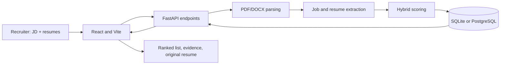

# TalentLens Project Guide

This guide explains how TalentLens works, why its main design choices exist, and when each part runs. For installation commands, see the [README](../README.md).

## At a glance

TalentLens turns a job description and a batch of resumes into a persisted, explainable shortlist. Parsing and extraction collect evidence; a deterministic scoring service combines that evidence with semantic similarity. Recruiters can inspect the score breakdown and the original resume before making a decision.



## The normal workflow

| When | What happens | Why |
| --- | --- | --- |
| A recruiter submits a new role | The backend extracts a title, skills, experience minimum, and qualification cues from the pasted or uploaded JD, then saves the role. | The same role can be reused and evaluated consistently. Extraction is a starting point; it is heuristic and should be checked against the JD. |
| Resumes are uploaded | Each PDF/DOCX is validated, hashed, parsed, profiled, scored against the selected role, and stored. | Batch processing saves time while keeping results traceable to the role. |
| A file has already been uploaded to this role | Its SHA-256 hash identifies it as a duplicate. Re-uploading refreshes the profile, scores, and retained original file. | A retry or newer parsing rule does not create a second candidate row for the same file and role. |
| The shortlist is opened | Candidates are returned in score order; the dashboard refreshes periodically. | New or refreshed candidates move into the appropriate ranking without manual sorting. |
| A role is edited | The UI first requests a score impact preview. Saving the edit applies the updated criteria and recalculates the role's candidates. | Recruiters can see how a changed JD affects the shortlist before applying it. |
| A candidate is opened | The app displays component scores, matched/missing skills, extracted employment, projects, education, and evidence. The Resume tab serves the retained original PDF or offers the DOCX download. | A score should be reviewable against its source evidence and original document. |

## How one resume is processed

1. **Validate the upload.** The API accepts PDF and DOCX, limits a batch to 100 files and each file to 15 MB, and reports errors per file so one invalid resume does not stop the batch. Empty or unreadable files are rejected. Scanned PDFs have no selectable text and need OCR before upload; OCR is not part of this project.
2. **Extract text.** `backend/app/services/parsing.py` uses PyMuPDF for PDF text and link annotations, and `python-docx` for DOCX paragraphs and tables. The original bytes are retained for PDF preview or DOCX download.
3. **Extract profile evidence.** `backend/app/services/extraction.py` identifies resume sections and extracts candidate name, skills, education, employment, projects, tools, links, and concise skill evidence. spaCy's English model can improve sentence/entity processing; regex extraction remains available if that model is absent.
4. **Remove identifying data from match text.** Before semantic matching, names, emails, phone numbers, and lines containing common sensitive attributes are removed from resume text. Email may be stored for future product use, but is not returned by the candidate analysis endpoint or used in scoring. Names and contact details do not contribute to candidate rank.
5. **Score and persist.** `backend/app/services/scoring.py` calculates applicable components, renormalizes their weights, and saves the score, profile, parsed text, and original file in the configured database.

The parser uses section headings and patterns rather than a resume-specific machine-learning model. Resumes have many layouts, so extracted fields are evidence to review, not guaranteed facts. Candidate detail is re-extracted from stored text with the current parser; **Refresh saved scores** also persists the new extraction and recomputed ranking for the selected role.

## How matching and ranking work

Default weights are configured in `backend/app/services/scoring.py`:

| Component | Default weight | How it is measured |
| --- | ---: | --- |
| Skills | 50% | Required skills matched, with preferred skills counted at half weight. Aliases such as `K8S` and `Kubernetes` normalize to the same skill. |
| Semantic similarity | 25% | Cosine similarity between normalized job text and candidate resume text using `all-MiniLM-L6-v2`. If the model cannot load, a token-overlap fallback is used. |
| Experience | 15% | Candidate years divided by the JD's stated minimum, capped at 100. It is N/A when the JD has no minimum or the resume has no usable experience data. Project duration is not treated as employment experience. |
| Education | 10% | Available degree, branch/field, and GPA evidence compared with qualifications extracted from the JD. |

For a candidate with applicable component scores, the overall score is:

```text
overall = sum(component_score × component_weight) / sum(applicable_component_weights)
```

If a component is missing or not relevant, it is marked N/A and left out of both sums. That prevents absent data from acting like a zero or a perfect match. Scores are clipped to the 0–100 range. If there are no applicable components at all, the overall score is 0.

### Education matching details

Education scoring uses the highest education record grouped from the resume and compares the details that are available on both sides:

- Degree level contributes 50%: doctoral rank 5, M.Tech/master's rank 4, B.Tech/bachelor's rank 3, Class 12 rank 2, Class 10 rank 1. A candidate at or above a degree level explicitly requested in the JD gets full degree credit; lower levels receive proportional credit.
- Branch/field contributes 30%. Exact field matches receive full credit. Recognized related technology fields (including CSE, IT, computer/software engineering, AI/data science, electronics, and computational mathematics) also receive full field-match credit. A clearly unrelated field such as Civil Engineering receives zero field credit against CSE.
- GPA contributes 20%. The candidate's GPA is normalized to its stated scale and compared with the JD's threshold; meeting or exceeding the threshold receives full credit.

The education component renormalizes over dimensions found in both the JD and resume. Example: B.Tech Civil with 9/10 versus B.Tech CSE with an 8/10 minimum gets full degree credit, zero branch credit, and full GPA credit: `(50×100 + 30×0 + 20×100) / 100 = 70%`. B.Tech IT with 9/10 gets full credit for a CSE requirement because IT is treated as a related technology branch.

The skill, semantic, experience, and education scores are separate evidence signals. Semantic similarity is not the sole authority and no LLM makes the ranking decision.

## Why these safeguards exist

- **Per-file errors:** Invalid documents are reported individually so a batch can continue processing valid resumes.
- **Limits on file count and size:** Bound memory and request processing for local use; raise them only alongside suitable upload and storage limits.
- **Hash-based duplicate detection:** Stops the same document from appearing twice under one role while allowing a person to be evaluated for separate roles.
- **N/A score handling:** Missing experience or education evidence is not silently treated as a zero or 100%; only available components contribute to the overall score.
- **No sensitive attributes in ranking:** Resume contact details and common sensitive attributes are removed from the text used for semantic matching. Deterministic skill, experience, and education measures use role-related evidence.
- **Original-file review:** Extracted text can lose layout and parser errors are possible, so the recruiter can review the source PDF or download the original DOCX.
- **No OCR:** Scanned PDFs need OCR preprocessing. This keeps the service small and avoids presenting guessed text as extracted evidence.
- **Human review:** The score is a shortlist aid. Recruiters should inspect evidence and the original document before making decisions.

## Code map

| Path | Responsibility |
| --- | --- |
| `frontend/src/main.jsx` | Role form, batch upload, shortlist, candidate analysis, PDF preview, and DOCX download. |
| `frontend/src/style.css` | Dashboard and candidate analysis presentation. |
| `backend/app/main.py` | HTTP endpoints, validation/error handling, role/candidate persistence, and score refresh flow. |
| `backend/app/schemas.py` | Pydantic request validation for roles, previews, and score weights. |
| `backend/app/services/parsing.py` | PDF/DOCX text extraction and document errors. |
| `backend/app/services/extraction.py` | Job and candidate profile extraction, skill normalization, and grouping of project/education evidence. |
| `backend/app/services/scoring.py` | Semantic similarity, deterministic component scores, and weighted aggregation. |
| `backend/app/models.py` | SQLAlchemy Job and Candidate tables, including retained original file bytes. |
| `backend/app/database.py` | Database URL and SQLAlchemy engine/session setup. |
| `backend/tests/test_services.py` | Parsing, section grouping, skill matching, education, and scoring regression tests. |

## What the current project does not do

- It does not OCR image-only/scanned PDFs.
- It does not guarantee accurate extraction from every resume layout or every way of writing a qualification.
- The JD extraction is rule-based; verify extracted criteria when precision matters.
- There is no account/login or role-based access control. The current setup is intended for local use or a trusted environment, not direct public exposure.
- The semantic model's first use requires a model download unless it is already cached; the fallback is less capable than the embedding model.

For installation, PostgreSQL setup, API endpoints, tests, and run commands, continue to the [README](../README.md).
